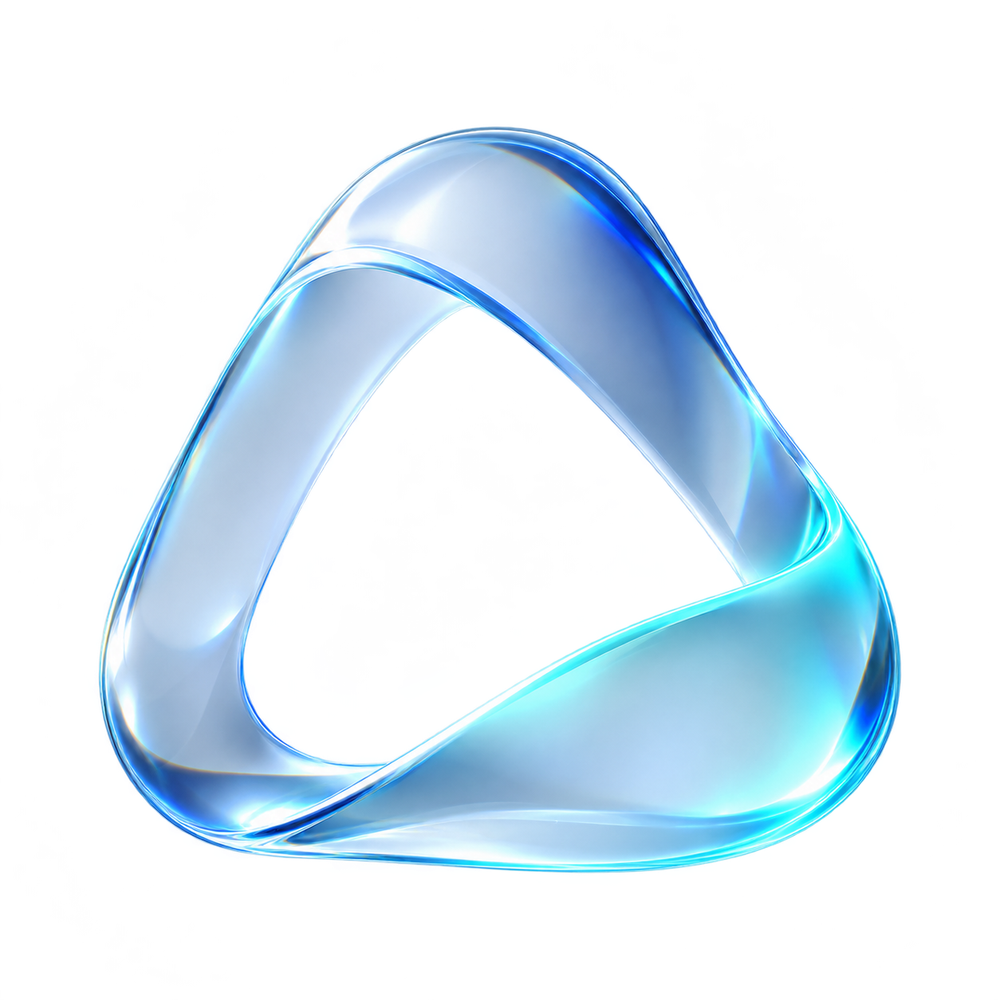
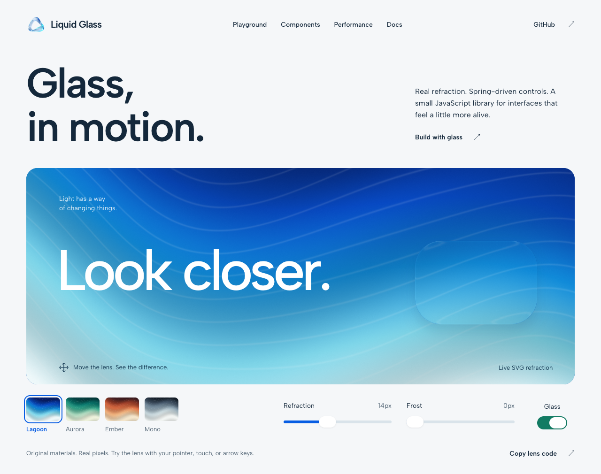
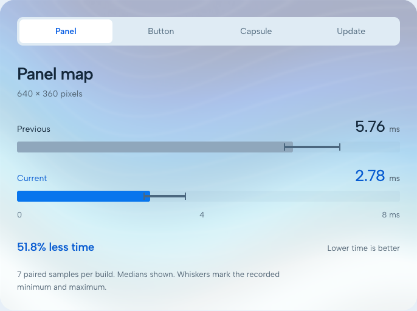

<p align="center">
  
</p>

<h1 align="center">Liquid Glass</h1>

Add refractive glass, frosted blur and edge highlights to web interfaces. Use ready-made web components or create your own effects with the JavaScript engine. No runtime dependencies, package manager or build step required.

[Live showcase](https://tfdmendes.github.io/liquidglass/) · [Documentation](https://tfdmendes.github.io/liquidglass/docs/) · [Quick start](#quick-start) · [Components](#components) · [Performance](#performance)



This is a fork of [gentpan/liquidglass](https://github.com/gentpan/liquidglass), focused on reducing repeated rendering work while retaining the original API. The original engine and components are by gentpan.

## Quick start

Copy [`lib/components.js`](lib/components.js) and [`lib/liquid-glass.js`](lib/liquid-glass.js) into a `lib/` directory in your project. Load the components once, then use them in your HTML:

```html
<script type="module" src="./lib/components.js"></script>

<lg-button>Continue</lg-button>
<lg-switch checked>Wi-Fi</lg-switch>
<lg-slider value="40" label="Volume"></lg-slider>
```

Serve the page through your app's development server so the browser can load the modules. The library works with plain HTML and browser-based frameworks. See [the framework examples](docs/index.html#frameworks) for React and Vue.

### Glass over an image

Place a component over an image and set `data-lg-backdrop="img"` on their container. This tells the component which image to refract. Replace `photo.jpg` with an image in your project:

```html
<div data-lg-backdrop="img" style="position: relative; max-width: 640px;">
  
  <lg-button style="position: absolute; left: 24px; bottom: 24px;">
    Continue
  </lg-button>
</div>
```

## Components

| Purpose | Components |
| --- | --- |
| Controls | `<lg-button>`, `<lg-switch>`, `<lg-slider>`, `<lg-segmented>` |
| Panels | `<lg-panel>` |
| Navigation | `<lg-navbar>`, `<lg-dock>` |
| Menus | `<lg-menubar>`, `<lg-menu>` |
| Notifications | `<lg-toast>` and the `toast()` helper |
| Custom lenses | `<lg-lens>` |

Try every component in the [live showcase](https://tfdmendes.github.io/liquidglass/#components), including the movable lens, material picker, menus and notifications.

The segmented control supports click, keyboard and press-and-drag selection. Its lens follows the pointer and snaps to an enabled option on release. Use `radius="capsule"` for a capsule outline.

See the [component reference](docs/index.html) for attributes, events and examples, or [theming](docs/index.html#theming) for CSS variables.

## Use the engine directly

For a custom effect, copy only `lib/liquid-glass.js` and import `createGlass`. The engine bends the element's own content and background, so give it a size and something visible to render:

```html
<div id="glass" style="width: 320px; height: 180px; background: #b6d0ee;">
  Your content
</div>

<script type="module">
  import { createGlass } from './lib/liquid-glass.js';

  const glass = createGlass(document.getElementById('glass'), {
    fit: true,
    clip: true,
    radius: 24,
    blur: 2,
  });
</script>
```

`fit` follows the element's size, `clip` trims it to the lens shape, and `radius` and `blur` use CSS pixels. Change settings with `glass.update({ blur: 4 })`. When removing the element, call `glass.destroy()` to release its filters and observers.

The [core API reference](docs/index.html#api) covers positioning, lens shape and optical settings. For video or canvas, also copy `lib/glass-webgl.js` and use [`createGlassRenderer`](docs/index.html#webgl). Keep the core and WebGL files from the same revision so they share the same optical model.

## Browser support

For components placed over a background, refraction depends on the backdrop and browser:

| Component backdrop | Chrome | Safari / WebKit | Firefox |
| --- | --- | --- | --- |
| Image marked with `data-lg-backdrop` | Refraction | Refraction | Refraction |
| Arbitrary page content | Refraction | Frosted blur | Frosted blur |

Recorded checks cover Chrome, Firefox and native macOS WebKit using desktop and phone-sized layouts. Physical iPhone behavior has not been tested. See the [validation coverage and limits](docs/performance/README.md#visual-evidence-limits).

## Performance

This fork reuses lens maps, reduces filter and scroll updates, and avoids idle WebGL redraws for unchanged image snapshots and paused videos.

Recorded comparisons against the previous optimized build found:

- **30–52% lower median time** to generate fresh maps.
- **12% lower median time** for synchronous updates using unique lens shapes.
- **640 byte-exact map comparisons**, with no changed pixels.



The timing results use seven paired samples and describe specific workloads. Headless animation results did not establish a general FPS gain. Earlier cache measurements also showed a small CPU cost when most maps were new.

- [Map and unique-lens update figures](docs/performance/current-map-time.svg)
- [Animation cadence and recorded ranges](docs/performance/current-animation-fps.svg)
- [Current benchmarks and limits](docs/performance/fps.md)
- [Synchronous animation update times](docs/performance/current-update-time.svg)
- [Historical charts and CPU measurements](docs/performance/README.md#historical-upstream-measurements)
- [Run the comparison site on your device](showcase/README.md)

## Try the demo locally

From the repository root, use Node.js 22 or newer to build and serve the complete website, documentation and three-build comparison. `--port 4173` selects the local port. The server listens only on `127.0.0.1` and regenerates the disposable `dist/` folder:

```sh
node scripts/serve-site.mjs --port 4173
```

Open the [showcase and playground](http://127.0.0.1:4173/liquidglass/) or [documentation](http://127.0.0.1:4173/liquidglass/docs/). Stop the server with **Ctrl+C**. Delete `dist/` to remove the generated files. The comparison requires the repository's full Git history. See [publication and preview details](docs/deployment.md).

## Development

Edit the source files in `lib/`. After changing the library, run these commands from the repository root to update the copies bundled with the [agent skill](skill/liquid-glass-web/SKILL.md) and check they match. The first overwrites the three copies in `skill/liquid-glass-web/assets/`; `--check` only reports differences. Review or revert the copied changes with Git:

```sh
sh scripts/sync-skill.sh
sh scripts/sync-skill.sh --check
```

Browser regression tests require Node.js, an existing Playwright installation and browser binaries. Run the segmented-control suite with Node's built-in test runner (`--test`); it starts a temporary local server and closes it after the checks:

```sh
node --test tests/segmented.test.mjs
```

If Playwright is installed outside this repository, set `LG_PLAYWRIGHT_MODULE` to its `index.mjs` path. Chromium is the default; `LG_BROWSER=firefox` selects Firefox. Use `LG_CHROME_EXECUTABLE` or `LG_FIREFOX_EXECUTABLE` to choose an existing browser binary. Shared configuration, including legacy variable names, lives in [`review/browser-runtime.mjs`](review/browser-runtime.mjs).

For further development work:

- [`tests/`](tests/) contains the browser regression suites.
- [`review/`](review/README.md) contains comparison builders, fixtures and measurement records.
- [Combined regression checks](review/combined-validation.md) document reproduction commands and tested source hashes.
- [`assets/main.js`](assets/main.js) runs the showcase; [`assets/docs.js`](assets/docs.js) runs the reference pages.
- [`DESIGN.md`](DESIGN.md) records the visual direction, original materials and interaction requirements.
- [Refactor decisions](docs/refactor-decisions.md) explain the module boundaries.

## Credits and license

The original engine and components are by [gentpan](https://github.com/gentpan/liquidglass). This fork preserves the [MIT license and copyright notice](LICENSE).

The rendering approach was described by Aave Labs in [Building Glass for the Web](https://aave.com/design/building-glass-for-the-web); gentpan wrote an independent implementation. Icons are from [Lucide](https://lucide.dev), under the ISC license. The new showcase uses original procedural optical materials. Its self-hosted Albert Sans font includes the [SIL Open Font License](assets/fonts/OFL.txt). Historical comparison wallpapers in `images/` belong to their respective owners and are not covered by the MIT license.
