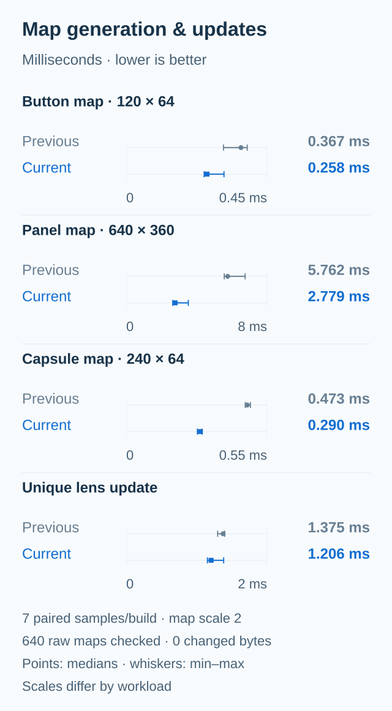
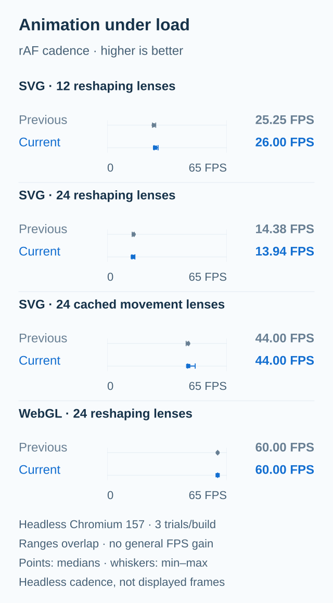
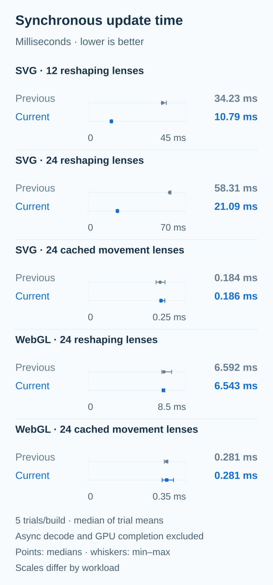

# Performance evidence

## Current engine

These figures use the recorded measurements from 6 November 2026. They compare the previous optimized build at `938df92` with the current engine. The generator checks that the recorded library hashes still match `lib/` before drawing them.



The labels show absolute milliseconds on zero-based scales. Each workload has its own printed scale; compare Previous and Current within a workload. Points show medians and whiskers show the recorded minimum and maximum. Map timings use seven paired samples per build.





Animation measurements use three trials per build. FPS means browser `requestAnimationFrame` cadence, and update time is the median of the trials' mean synchronous update times. FPS ranges overlap, and the heavier SVG scene is slower in these samples. These results do not establish a general FPS gain.

The [full methods and limits](fps.md), [raster report](raster-spans-results.json) and [animation report](https://github.com/tfdmendes/liquidglass/blob/main/showcase/recorded-fps.json) retain the source hashes and measurement details. Regenerating a figure redraws those records; it does not run a new benchmark. The current FPS runner differs from the runner identified in the saved report, so these plots are attributed to that recorded run.

## Historical upstream measurements

The [first raster pass](raster.md) compares the earlier integrated fork at `862e553` with the retained `previous` build. It remains separate from both the current-engine charts above and the independent upstream experiments below.

These figures use measurements from the 26 October 2026 review. Each of the four
changes was measured **independently** against upstream
`068ad226f53e1ca62d857f78bdc32f58f3c5fce7`. They do not measure the integrated
fork or establish a combined speedup. The original engine is by
[gentpan](https://github.com/gentpan); the project retains its upstream MIT license.


The rows count different operations. Their bar lengths can be compared within a
row; the counts cannot be added or interpreted as CPU savings.

| Measurement | Original → individual change | Same workload in both variants |
| --- | --- | --- |
| Map PNG encodes | 149 → 41 | Button, 12 deterministic press/release cycles; Chrome 156, 1280 × 900, DPR 2 |
| Initial SVG attribute writes | 182 → 62 | One static lens; Blink and Gecko recorded the same counts. Native WebKit remained 197 → 197 |
| Scroll geometry reads | 33,524 → 8,561 | 35 scroll positions with 240 extra surfaces; Chrome 156, 1280 × 800, DPR 1. The phone run recorded 8,569 candidate reads |
| Idle WebGL source uploads | 18 → 0 | An unchanged ImageBitmap, sampled over 302 ms; Chrome 156, 1280 × 900, DPR 1 |

Live canvas and HTMLImageElement sources still render continuously. The idle
ImageBitmap result does not describe every WebGL source or active animation.


CPU measurements used three fresh-browser trials per variant, alternating order,
in Chrome 156.0.8078.48 (Blink) and Firefox 157.0 (Gecko), at 1280 × 900 and DPR 2.
Button and segmented replays used 12 cycles; the mostly-unique workload generated
1,200 maps while changing optical parameters. Fixed 60 Hz spring steps were
replayed faster than wall clock, so native paint work could be coalesced.

CPU time is the change in macOS `ps` accumulated CPU time for the browser process
and its descendants, including map generation, equality checks, canvas upload,
PNG encoding/decoding and rendering tasks. Resolution is 10 ms per process.
WindowServer and graphics drivers are excluded. Final decode/repaint waits remain
inside the sampled interval. This does not measure CPU utilization, energy, FPS
or real-time frame cost. The mostly-unique median increased by 40 ms in Chrome
(+1.5%) and 20 ms in Gecko (+1.1%). Shared-host variance is visible in the ranges;
three trials do not establish statistical significance.

## Retained data and reproduction

[evidence.json](evidence.json) retains exact selected JSON subtrees, all 36 CPU
sample values, source SHA-256 hashes, JSON pointers and the reviewed candidate
module hashes. It omits process IDs, screenshots and unrelated test output.
The hash of `orchestrator-review.md` identifies the coordinated review behind
the broader caveats below.

| Source ID | Original measured artifact | Used for |
| --- | --- | --- |
| `map_summary` | `map-cache-results.json` | CPU medians/ranges and visual summary |
| `map_blink` | `blink-cpu-final.json` | Raw Chrome CPU samples and button operation counts |
| `map_gecko` | `gecko-cpu-final.json` | Raw Gecko CPU samples |
| `filters` | `filter-refresh-evidence.json` | Initial SVG writes and native unchanged counts |
| `scroll` | `surface-scroll-results.json` | Desktop/phone reads and phone repeat controls |
| `webgl` | `webgl-demand-results.json` | The named idle ImageBitmap sample and its runtime |

All five figures are rendered with Matplotlib 3.11.0. The current-engine charts use a consistent light surface, direct labels and min–max whiskers. Their source and rendering code live in [`current_figures.py`](https://github.com/tfdmendes/liquidglass/blob/feat/liquidglass-showcase/docs/performance/current_figures.py). The [website](https://tfdmendes.github.io/liquidglass/#performance) reads the same recorded JSON into a responsive glass chart with selectable workloads.

The historical figures retain blue and orange from [MATLAB's gem palette](https://www.mathworks.com/help/matlab/ref/colororder.html), light grid lines and two vertically stacked CPU panels. MATLAB itself is not required.

Run from the repository root with Python 3 and the pinned plotting dependency.
The first two commands create a temporary Python environment and install
Matplotlib and its dependencies there. `-m` runs the named Python module;
`--requirement` reads the pinned package list. This does not install packages
globally or add a runtime dependency to the glass library. Remove
`/tmp/liquidglass-plots` to remove that environment.

The third command regenerates the five SVGs. The fourth checks their XML,
recomputes CPU medians/ranges from the retained samples, checks them against the
review summary, validates current library hashes and compares the generated SVGs byte for byte without writing.
Regeneration redraws existing evidence; it does not rerun the browser benchmarks.

```sh
python3 -m venv /tmp/liquidglass-plots
/tmp/liquidglass-plots/bin/python -m pip install --requirement docs/performance/requirements.txt
/tmp/liquidglass-plots/bin/python docs/performance/generate.py
/tmp/liquidglass-plots/bin/python docs/performance/generate.py --check
```

When a complete original artifact is available, add
`--verify-source ID=PATH` to check its SHA-256 and every retained JSON pointer.
The source IDs are listed above; the path is supplied locally and is not saved.
SVGs have accessible titles/descriptions, an opaque background and embedded
light/dark colors. Text remains selectable, with sans-serif font fallbacks.
They contain no script, embedded font or external asset. The pinned Matplotlib
version, fixed SVG IDs and omitted timestamps keep regeneration deterministic.

## Visual evidence limits

The review covered Blink, Gecko and native macOS WebKit, including desktop and
390 × 844 layouts. Map checks compared exact RGBA map output; Gecko rendered
states were exact, while Chrome's maximum one-channel difference of 1 also
occurred in original-versus-original controls. Native WebKit map captures were
limited to two states at backing DPR 2 on macOS 27.0.1.

Filter comparisons recorded 208 exact RGBA pairs. Scroll captures were exact in
Gecko, desktop Chrome and the sampled native WebKit states. **Phone Chrome scroll
captures were not pixel-exact**: cross-comparisons changed 203/510/197 pixels,
with repeat-control differences too. An unfiltered gradient boundary reached a
one-channel difference of 165 in cross and repeat controls; the remaining
differences were at most 1. The native large-scene scroll replay used seven
positions, so it does not supply the plotted 35-position operation counts.

No physical iPhone was tested. Native WebKit does not cover every DPR,
reduced-motion setting or live backdrop. Captured states do not prove every
intermediate frame or historical browser version. Real background-tab suspension
was not established by the synthetic visibility and viewport checks.

The historical figures passed XML and deterministic-output checks. Browser image
renders were inspected at 760 px and 390 px in light and dark themes, with no
horizontal overflow. This checks local SVG rendering; it is not a live GitHub
or physical-phone test.

The current-engine figures were rendered locally at 800 px and 358 px in both themes. Their text bounds had no clipping or overlap, and a separate visual review covered all three metrics at both sizes. These are presentation checks of the exported SVGs, separate from the recorded benchmark runs.
